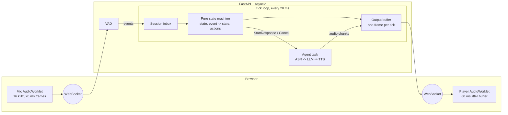
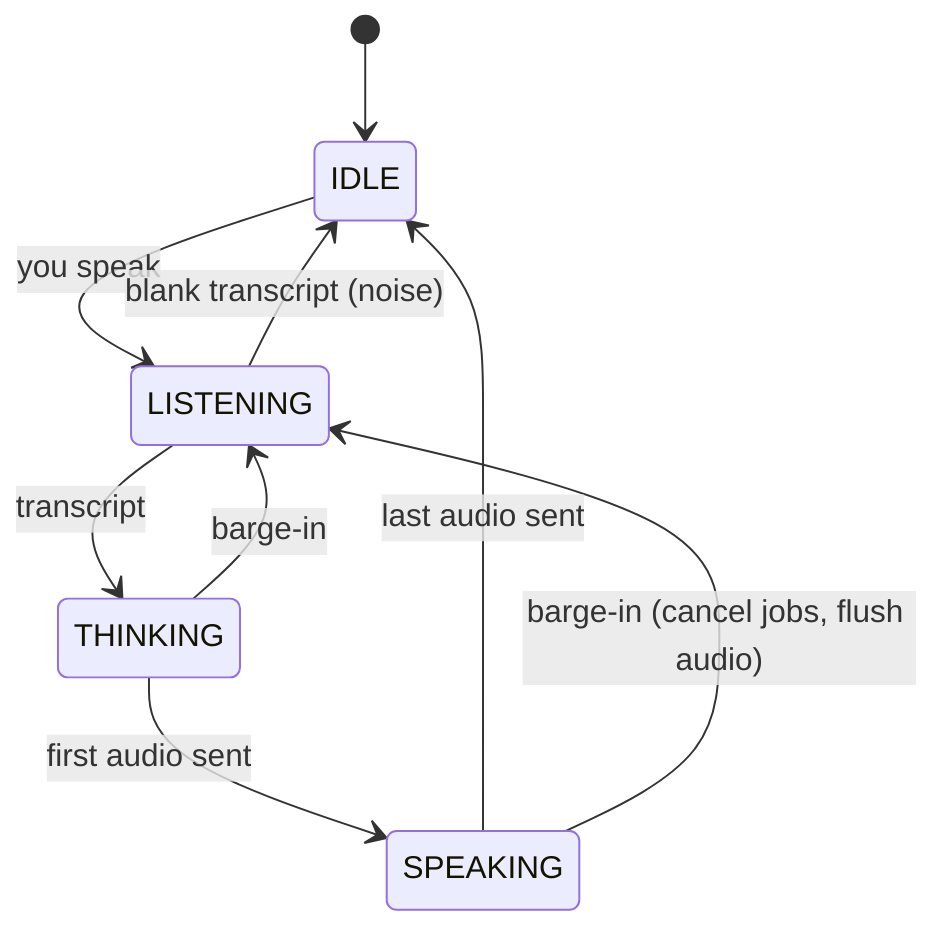

# duplex-engine

A real-time engine for a full-duplex voice agent: it listens while it speaks, and stops within one 20 ms tick when you interrupt it.

Most voice bots take turns like a walkie-talkie: listen, think, speak, repeat. This project builds the runtime that lets a conversation overlap, the way people actually talk. A fixed-rate tick loop keeps audio flowing no matter how slow the AI models are, and a pure state machine decides who has the floor.

> **Status:** Steps 1–4 of 9 are done. The full real-time path works end to end with a stand-in "echo agent" that plays your own words back. Speech recognition, an LLM and text-to-speech come next (see [Roadmap](#roadmap)).

## Demo

Run the server, open the page, say a sentence and pause: the agent replies. Talk over it and it stops.

```
  2376 ms  VAD: speech start
  2384 ms  -> LISTENING
  4056 ms  VAD: speech end
  4066 ms  transcript [1500 ms of speech]
  4066 ms  -> THINKING
  4385 ms  -> SPEAKING (TTFO 329 ms)
  5884 ms  -> IDLE
```

## Architecture



### The conversation state machine



## Design decisions

**A fixed 20 ms tick, not a chain of callbacks.** AI models deliver output in uneven bursts. The tick loop separates the slow world (models running as async tasks, writing into buffers) from the real-time world (one frame out every 20 ms, silence if nothing is ready). Output never stalls, and timing is measurable.

**Drift-free deadlines.** Tick `n` is due at `start + n × 20 ms`, so small delays never accumulate. If the loop falls more than a tick behind, it skips ahead rather than bursting to catch up, because a burst of audio sounds worse than a gap. Lateness, work time, overruns and skips are all recorded.

**A pure state machine.** `transition(state, event) -> (new_state, actions)` has no I/O, no asyncio and no models. It is trivial to test, and it is the part designed to be ported to Rust: the same tests can check both versions.

**Events apply only on a tick.** Anything can `post()` an event at any time, but state changes happen at one point, in order. A barge-in flushes the output buffer before that tick picks its frame, so no stale speech goes out after an interrupt.

**State follows what the listener hears.** `SPEAKING` starts when the first agent frame is actually sent and ends when the last one is, not when TTS finishes generating. Late events from cancelled jobs are ignored.

## Measured so far

| Metric | Result | Notes |
| --- | --- | --- |
| Barge-in, inside the engine | ≤ 1 tick (20 ms) | Flush happens in the same tick the interrupt is applied |
| Tick work time, p99 | 0.04 ms of a 20 ms budget | `python -m bench.tick_demo`, Linux |
| Tick lateness, p99 | 1.6 ms (Linux) | Windows needs 1 ms timer resolution, set at server start |
| TTFO with the echo agent | ~330 ms from VAD end | Includes a simulated 300 ms model delay; measured from VAD's end-of-turn decision, which itself waits 500 ms |

Real-model latency breakdowns (ASR, LLM first token, TTS first audio) arrive with Steps 5–8.

## Run it

Requires Python 3.10+ and Chrome or Edge.

```bash
git clone https://github.com/k-sahi/duplex-voice-agent.git
cd duplex-voice-agent
python -m venv .venv
# Windows: .venv\Scripts\activate    Mac/Linux: source .venv/bin/activate
pip install -r requirements.txt

pytest -q                          # run the tests
python -m bench.tick_demo          # scripted conversation with a barge-in, plus tick stats
uvicorn server.main:app --reload   # then open http://localhost:8000
```

Use headphones for the live demo. Without them the agent hears its own voice and interrupts itself; handling that properly is part of Step 7.

## Project layout

```
engine/
  state_machine.py   pure turn-taking logic
  tick.py            20 ms tick loop with timing stats
  audio.py           frame constants and the output buffer
  session.py         one conversation, advanced only by ticks
  vad_energy.py      loudness-based VAD (placeholder for Silero)
server/
  main.py            FastAPI app: page at /, audio at /ws
  connection.py      per-browser connection, echo agent, event stream
client/
  index.html         mic capture, playback, state and latency display
tests/               state machine, buffer, tick, VAD and end-to-end tests
bench/
  tick_demo.py       scripted conversation with a fake TTS
```

## Roadmap

- [x] Step 1: project setup
- [x] Step 2: pure state machine with barge-in
- [x] Step 3: 20 ms tick loop, output buffer, session
- [x] Step 4: WebSocket server, browser client, echo agent
- [ ] Step 5: Silero VAD and streaming speech recognition (faster-whisper)
- [ ] Step 6: streaming LLM and streaming TTS (Piper), sentence-level chunking
- [ ] Step 7: real barge-in with task cancellation and self-interruption handling
- [ ] Step 8: per-stage latency tracing, p50/p95/p99 benchmarks, regression checks
- [ ] Step 9: port the state machine and tick core to Rust (PyO3)
