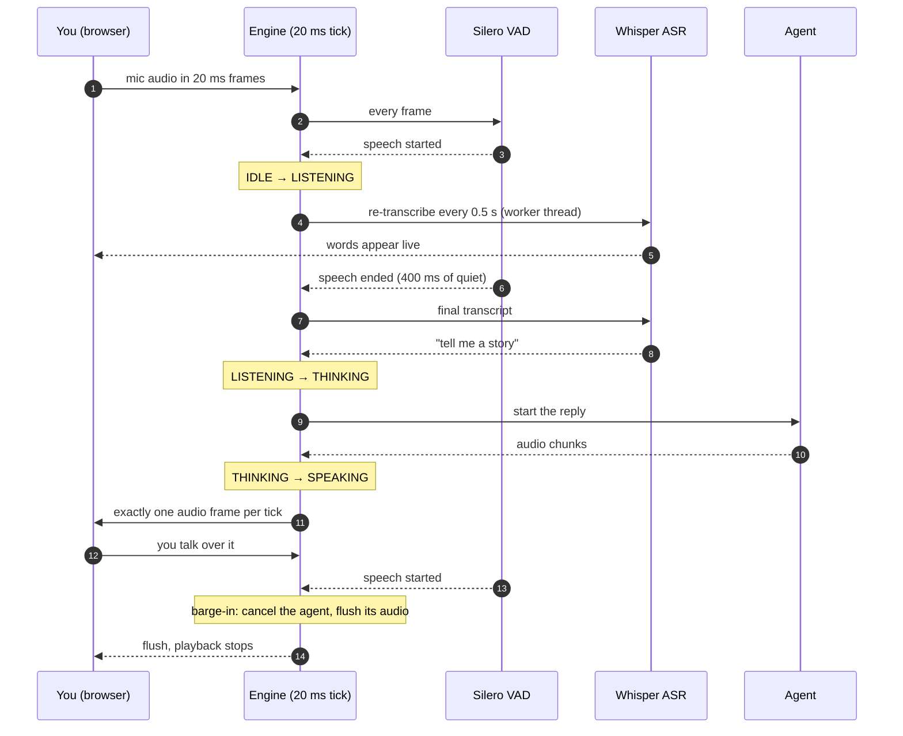
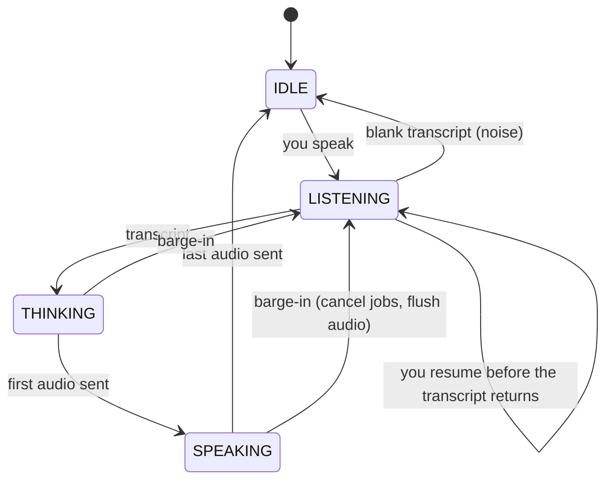
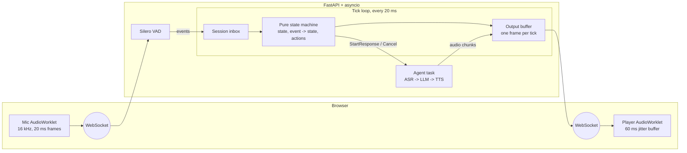

<div align="center">

# duplex-engine

**A real-time voice agent you can interrupt mid-sentence.**<br>
It listens while it speaks, and stops within one 20 ms tick when you talk over it.

[](https://nivi2700-duplex-voice-agent.hf.space)




[Try it live](#try-it-live) · [How it works](#how-it-works) · [Design decisions](#design-decisions) · [Numbers](#measured-so-far) · [Run it locally](#run-it-locally) · [Roadmap](#roadmap)

</div>

---

Most voice bots take turns like a walkie-talkie: listen, think, speak, repeat. This project builds the runtime that lets a conversation overlap, the way people actually talk. A fixed-rate tick loop keeps audio flowing however slow the AI models are, and a pure state machine decides who has the floor.

> [!NOTE]
> **Status: steps 1–5 of 9 are done.** The engine hears you with Silero VAD and transcribes you live with faster-whisper. The reply is still a stand-in "echo agent" that plays your own words back; an LLM and a real voice come next (see the [roadmap](#roadmap)).

## Try it live

1. Open the **[live demo](https://nivi2700-duplex-voice-agent.hf.space)** in Chrome or Edge and put on headphones.
2. Click **Start** and allow the microphone.
3. Say a sentence and pause. Your words appear as you speak, then the agent plays them back.
4. **Talk over it while it plays.** It stops at once, and the log shows `cancel agent jobs` and `flush playback`.

> [!TIP]
> Without headphones the agent hears its own voice and interrupts itself. The demo runs on a free shared CPU, so its numbers include your network round trip, and the first visit after a quiet spell can take a minute while it wakes up.

## How it works

One conversation turn, including an interruption:



Every decision about who is talking is made by one small, pure function:



<details>
<summary><b>Architecture diagram</b> (browser, server, tick loop)</summary>



</details>

## Design decisions

Click any decision to see why.

<details>
<summary><b>A fixed 20 ms tick, not a chain of callbacks</b></summary>
<br>

AI models deliver output in uneven bursts. The tick loop separates the slow world (models running as async tasks, writing into buffers) from the real-time world (one frame out every 20 ms, silence if nothing is ready). Output never stalls, and timing is measurable.

</details>

<details>
<summary><b>Drift-free deadlines</b></summary>
<br>

Tick `n` is due at `start + n × 20 ms`, so small delays never pile up. If the loop falls more than a tick behind, it skips ahead rather than bursting to catch up, because a burst of audio sounds worse than a gap. Lateness, work time, overruns and skips are all recorded.

</details>

<details>
<summary><b>A pure state machine</b></summary>
<br>

`transition(state, event) -> (new_state, actions)` has no I/O, no asyncio and no models. It is trivial to test, and it is the part designed to be ported to Rust: the same tests can check both versions.

</details>

<details>
<summary><b>Events apply only on a tick</b></summary>
<br>

Anything can `post()` an event at any time, but state changes happen at one point, in order. A barge-in flushes the output buffer before that tick picks its frame, so no stale speech goes out after an interrupt.

</details>

<details>
<summary><b>Models never run on the tick</b></summary>
<br>

Whisper takes hundreds of milliseconds per call, so every transcription runs through `asyncio.to_thread` on a worker thread. The model is loaded once with two workers, so a final transcript never waits behind a partial one. A turn counter drops results that arrive after the user has moved on.

</details>

<details>
<summary><b>A speech gate with hysteresis</b></summary>
<br>

Silero gives a speech probability for every 32 ms of audio, and raw probabilities flicker. A turn starts above 0.5 but only ends below 0.35, so borderline sounds cannot flip the state back and forth. Starting needs 100 ms of confident speech (a click is ignored); ending needs 400 ms of quiet (a pause between words is not).

</details>

<details>
<summary><b>One turn, even with a pause</b></summary>
<br>

If you stop for a moment and keep talking before the transcript comes back, the engine keeps your earlier words and transcribes the whole sentence as one turn. The half-sentence transcript is dropped.

</details>

<details>
<summary><b>State follows what the listener hears</b></summary>
<br>

`SPEAKING` starts when the first agent frame is actually sent and ends when the last one is, not when the reply finishes generating. Late events from cancelled jobs are ignored.

</details>

## Measured so far

| Metric | Result | How it was measured |
| --- | --- | --- |
| Barge-in, inside the engine | **≤ 1 tick (20 ms)** | The flush happens in the same tick the interrupt is applied (`tests/test_session.py`) |
| Tick work time, p99 | **0.04 ms** of a 20 ms budget | `python -m bench.tick_demo`, Linux |
| Tick lateness, p99 | **1.6 ms** | Same run. Windows needs 1 ms timer resolution, which the server sets at start |
| Time to first output, echo agent | **~330 ms** after the end of your turn | Step 4 run, including a simulated 300 ms model delay. The live page shows TTFO and Whisper's time for every turn |

Full per-stage breakdowns (speech-to-text, LLM first token, first audio) arrive in Steps 6–8.

## Run it locally

Requires Python 3.10+ and Chrome or Edge.

```bash
git clone https://github.com/k-sahi/duplex-voice-agent.git
cd duplex-voice-agent
python -m venv .venv
# Windows: .venv\Scripts\activate    Mac/Linux: source .venv/bin/activate
pip install -r requirements.txt

pytest -q                          # 29 tests, no models needed
python -m bench.tick_demo          # scripted conversation with a barge-in, plus tick stats
uvicorn server.main:app            # then open http://localhost:8000
```

The first server start downloads the Whisper model (about 140 MB for `base.en`).

<details>
<summary><b>Settings</b> (environment variables)</summary>
<br>

| Variable | Default | Options |
| --- | --- | --- |
| `DUPLEX_ASR_MODEL` | `base.en` | `tiny.en` (faster), `small.en` (more accurate) |
| `DUPLEX_ASR` | `whisper` | `none`: no speech-to-text, reports audio length instead |
| `DUPLEX_VAD` | `silero` | `energy`: simple loudness check, no PyTorch needed |
| `DUPLEX_MAX_SESSIONS` | `3` | How many people can talk to one server at once |

</details>

<details>
<summary><b>Run it with Docker</b></summary>
<br>

```bash
docker build -t duplex-engine .
docker run -p 7860:7860 duplex-engine     # then open http://localhost:7860
```

The live demo is this same container on Hugging Face Spaces, deployed on every push by `.github/workflows/deploy-space.yml`.

</details>

<details>
<summary><b>Project layout</b></summary>
<br>

```
engine/
  state_machine.py   pure turn-taking logic
  tick.py            20 ms tick loop with timing stats
  audio.py           frame constants and the output buffer
  session.py         one conversation, advanced only by ticks
  speech_gate.py     turns speech probabilities into start/end, with hysteresis
  vad_energy.py      loudness-based VAD (fallback)
server/
  main.py            FastAPI app: page at /, audio at /ws, loads models once
  connection.py      per-browser connection: VAD, partial + final ASR, echo agent
  vad.py             Silero VAD wrapper (512-sample windows)
  asr.py             faster-whisper wrapper, run on worker threads
client/
  index.html         mic capture, playback, state and latency display
tests/               state machine, buffer, tick, VAD, gate and end-to-end tests
bench/
  tick_demo.py       scripted conversation with a fake voice
docs/
  barge-in.svg       the animation at the top of this page
```

</details>

## Roadmap

- [x] **Step 1:** project setup
- [x] **Step 2:** pure state machine with barge-in
- [x] **Step 3:** 20 ms tick loop, output buffer, session
- [x] **Step 4:** WebSocket server, browser client, echo agent
- [x] **Step 5:** Silero VAD and live speech recognition (faster-whisper)
- [ ] **Step 6:** streaming LLM and streaming text-to-speech (Piper), sentence by sentence
- [ ] **Step 7:** real barge-in with task cancellation and self-interruption handling
- [ ] **Step 8:** per-stage latency tracing, p50/p95/p99 benchmarks, regression checks
- [ ] **Step 9:** port the state machine and tick core to Rust (PyO3)
